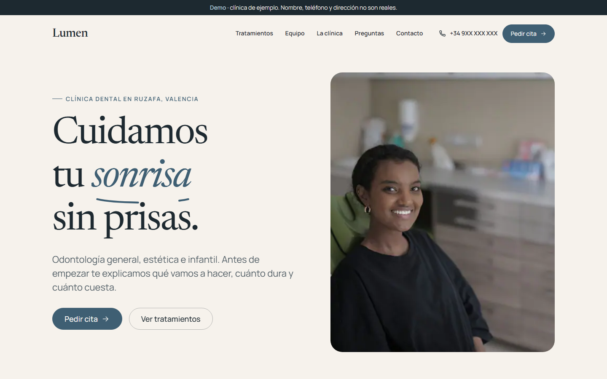

# Clínica Dental Lumen

Site de demonstração para clínicas odontológicas na Espanha, personalizável por um arquivo de configuração.

**[▶ Ver o site ao vivo](https://kaynanfrontend.github.io/clinica-dental-lumen/)**

## Sobre
Modelo de site para clínicas odontológicas na Espanha, em espanhol, com uma clínica de exemplo ("Lumen", em Valencia). As páginas são geradas por um script Node.js a partir de um único arquivo de configuração, com textos, horários, fotos e tema. Assim, cada nova clínica ganha o próprio site sem mexer no código. Este repositório tem o site já gerado.

Tipo: Site de demonstração

## Tecnologias
- HTML5
- CSS3
- JavaScript
- GSAP
- ScrollTrigger
- Lenis
- Node.js (gerador do site)

## Destaques
- Três temas visuais ("calma", "cercana" e "premium") definidos por design tokens em variáveis CSS
- Horário de funcionamento que mostra em tempo real se a clínica está aberta, no fuso de Madrid, com feriados e dias especiais
- Imagens responsivas com `srcset` em WebP, fontes locais pré-carregadas e dados estruturados (JSON-LD) para SEO local
- Páginas legais (aviso legal, privacidade e cookies) e página 404, além de respeitar `prefers-reduced-motion`

---
Feito por **Kaynan Ribeiro de Sousa** · [musgoestudio.com](https://musgoestudio.com)
